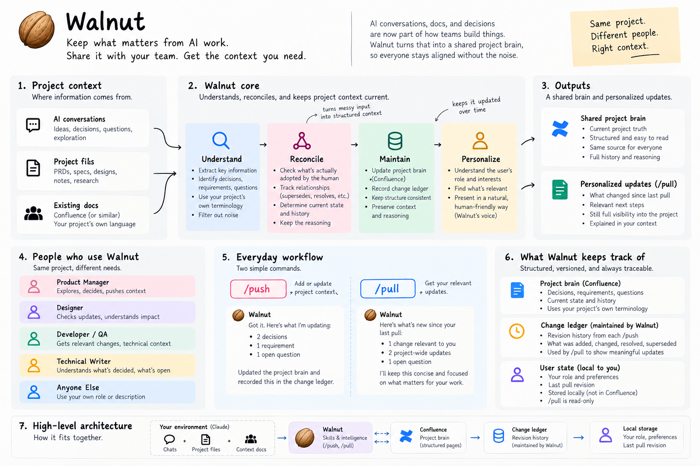

# Walnut

**Keep what matters from AI work. Share it with your team.**

Chats wander. Files change. The next person still needs to know what was decided, why, and what moved since they last checked.

Walnut keeps that story straight. `/push` carries confirmed project context into a shared project brain. `/pull` catches someone up in the context of their work.



## Two commands. One project story.

**Push what stuck.** Work normally with your AI. When something is settled, run `/push`. Walnut checks the conversation, current project docs, and the existing shared record. It adds or reconciles confirmed changes, keeps the history, records a change ledger, and reads the result back. An assistant suggestion does not become a decision just because it sounds useful.

**Pull what matters.** Joining a project? `/pull` explains the problem, direction, status, and what matters for your role. Coming back? It shows meaningful changes since your last successful pull. Your role changes the emphasis; important project-wide changes stay visible.

Nothing changed? Walnut says so and stops.

> **Public beta · v0.3** — a skills plugin for Claude Code. Confluence is the supported shared destination. Walnut uses the host AI and its existing connection; there is no separate Walnut service.

## Try it

You need Claude Code with plugin support, a working Confluence connection with page read/update capabilities, and a project page you are allowed to maintain. Pull-only readers need read access. Installing Walnut does not connect Confluence for you.

In Claude Code:

```text
/plugin marketplace add baburaokastylehai/walnut
/plugin install walnut@walnut
```

Claude Code namespaces plugin commands, so the two actions appear as:

```text
/walnut:push
/walnut:pull
```

The shorter `/push` and `/pull` names in the diagram describe those same actions. See the [Claude Code plugin documentation](https://code.claude.com/docs/en/plugins) for the host’s command and installation behavior.

On your first push, give Walnut the exact Confluence page URL. It verifies and remembers the target locally. On pull, describe your part in the project if it is not already clear. Useful existing context is enough; no role form or fixed document template is required.

To test a branch before it merges, run `claude --plugin-dir ./plugins/walnut` from its checkout. Marketplace installation follows `main`.

[Setup and migration](docs/SETUP.md) · [Fictional walkthrough](examples/nightjar/README.md)

## A small example

The fictional Nightjar team is building a telescope-booking calendar.

```text
Human: Six places per slot. Show remaining places before booking.
Assistant: We could send automatic reminders too.
Human: Let’s discuss availability next.

/push
→ saved the slot limit and available-places requirement.
  reminders stayed out of the shared record.

/pull — I’m testing this
→ each slot has six places. for QA, check the last available place
  and the first booking beyond capacity. the waiting-list question is still open.
```

That QA boundary is an implication of the confirmed limit, not a newly assigned task. The [full walkthrough](examples/nightjar/README.md) includes sources, the shared record, ledger, first pull, recurring pull, and a no-change run. Every example is fictional.

## What stays dependable

- **Your project’s language.** Walnut learns terms and actors from confirmed context.
- **History stays traceable.** Reversals supersede earlier decisions. Existing record IDs and child pages survive upgrades.
- **A shared change ledger.** Push records semantic changes; pull checks those events alongside current records, so manual page edits are still detected.
- **A personal checkpoint.** Pull remembers what one reader has seen locally. It never writes reader profiles into Confluence.
- **A restrained voice.** A small update gets a small response. Conflicts and partial writes are stated plainly.

## Know the limits

Walnut is an instruction-driven plugin, not a background sync engine. It only sees sources the host can access. It does not monitor all your chats, authenticate services, enforce access permissions, or guarantee that a model will interpret every change correctly. Review important updates.

Confluence is the only live adapter today. The Markdown walkthrough is a reproducible example, not another supported destination. Long ledgers, connector formatting differences, incomplete reads, and concurrent edits need care; [limitations and recovery](docs/LIMITATIONS.md) explain the boundaries.

Project state lives under `.walnut/` and the legacy `.claude/push-target.local.json`. Add these to your project’s ignore rules before use. **This repository’s `.gitignore` does not protect another project automatically.** Use separate local profiles or checkouts for different people.

## Build with us

[Contributing](CONTRIBUTING.md) · [Security](SECURITY.md) · [Architecture](docs/ARCHITECTURE.md) · [Release and rollback](docs/VERSIONING.md) · [Beta readiness](docs/BETA-READINESS.md)

Run `node scripts/validate-repo.mjs` and `node --test` with Node.js 22 or later. These check the package, shared ledger helper and fixtures; they do not prove a live Confluence run. See [evaluation](evals/README.md).

MIT licensed. Built by [Atharva Shembekar](https://github.com/baburaokastylehai).
